

# Orbit

**An AI helper that lives at your cursor.** 
Select text in any Windows app, press one shortcut, and pick what to do with it. The answer appears right next to your pointer. Free, no account, no tracking.

[Demo](#see-it-in-action) · [Screenshots](#screenshots) · [Download](#download) · [Get started](#get-started-in-2-minutes) · [Shortcuts](#shortcuts) · [Features](#what-you-can-do-with-it) · [Privacy](#privacy) · [Help](#help-and-feedback)

<a href="media/orbit-explainer.mp4">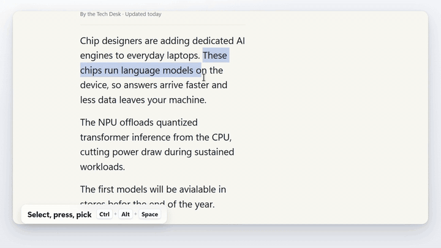</a>

Select text in a browser, a PDF, a chat or an editor, press **Ctrl+Alt+Space**, and a ring of actions opens at your pointer: translate, explain, rewrite, fix, summarize and more. The answer streams into a small box beside it, where you can copy it, paste it over your selection, or ask a follow-up.

Nearly 20 people have already downloaded version 0.0.16. Orbit is free, and you bring your own AI key (Anthropic, Google Gemini, OpenAI) or run a local Ollama model.

## See it in action

<a href="media/orbit-explainer.mp4">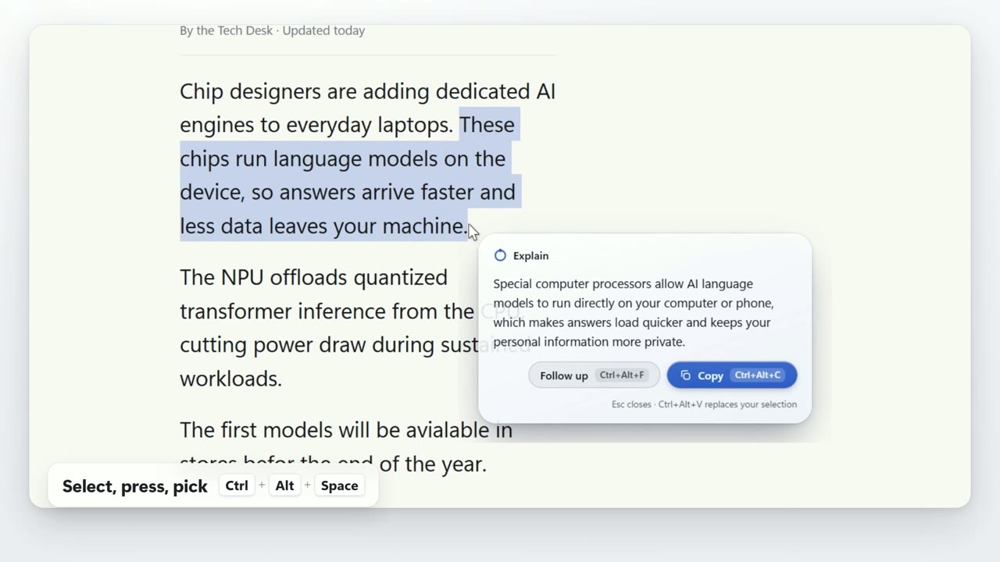</a>

**[Watch the 2-minute tour](media/orbit-explainer.mp4)**: every feature, narrated.

## Screenshots

<table>
<tr><td width="50%" valign="top">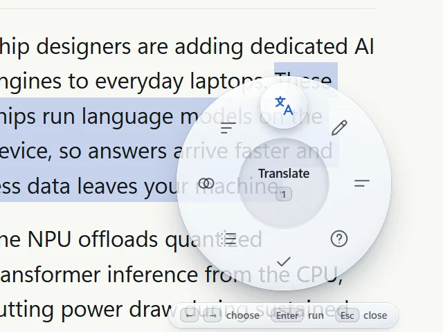 Ctrl+Alt+Space opens the ring at your pointer</td><td width="50%" valign="top">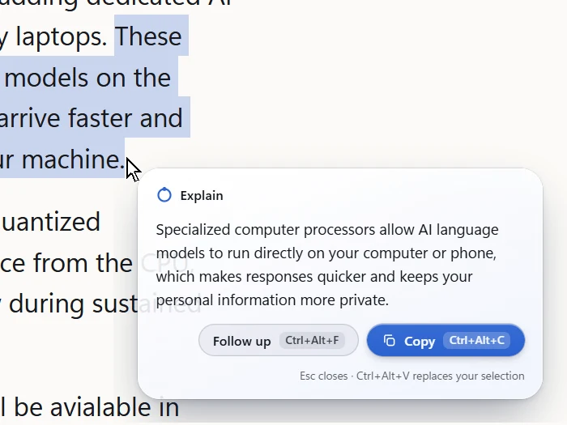 The answer streams in beside the pointer</td></tr>
<tr><td width="50%" valign="top">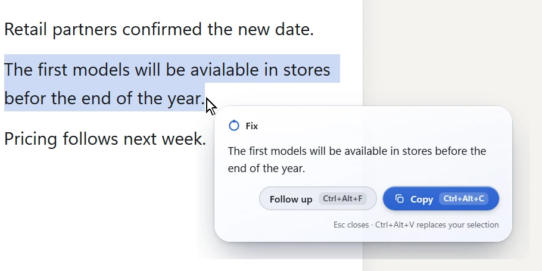 Fix suggests the corrected sentence, Ctrl+Alt+V puts it in place</td><td width="50%" valign="top">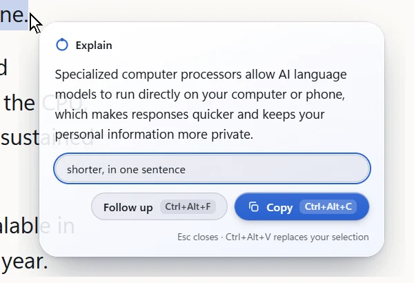 Ctrl+Alt+F: a follow-up on the answer</td></tr>
<tr><td width="50%" valign="top">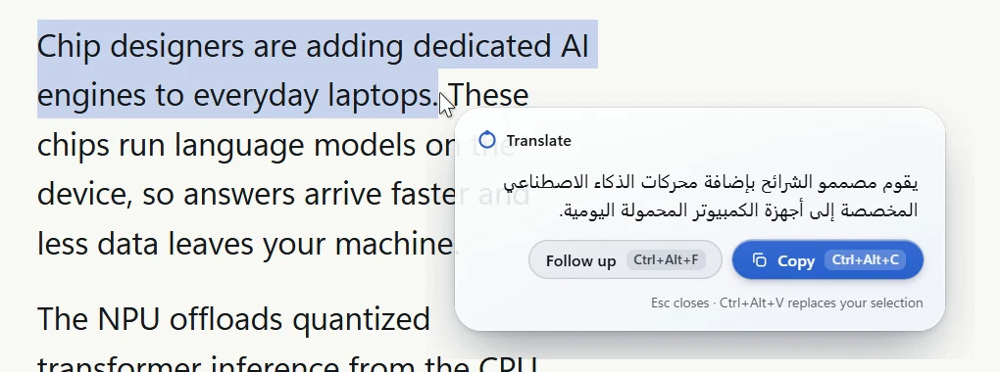 111 languages, right to left included</td><td width="50%" valign="top">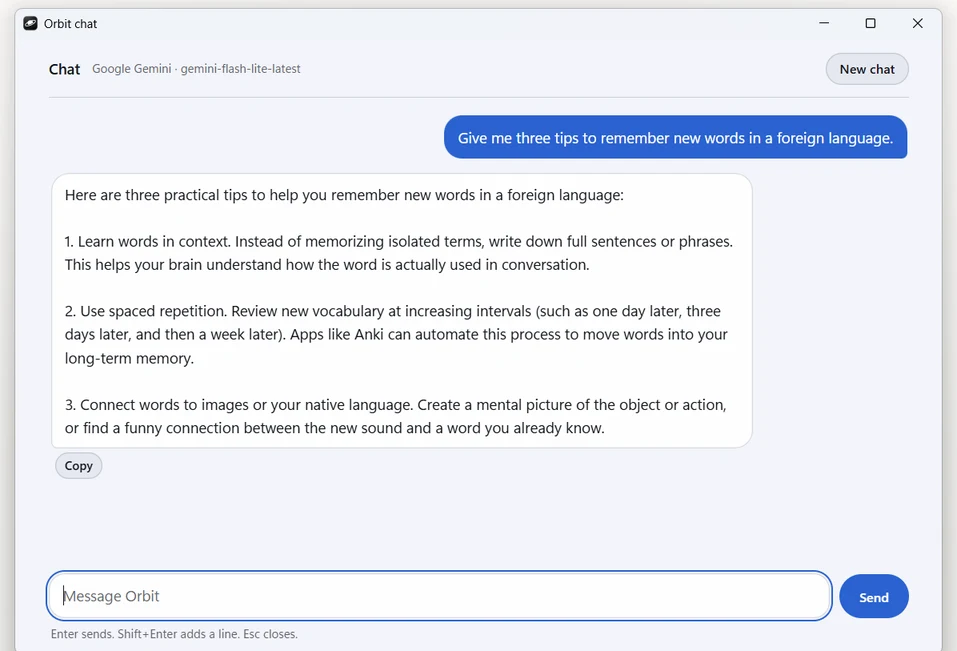 The chat window (Alt+Q)</td></tr>
<tr><td width="50%" valign="top">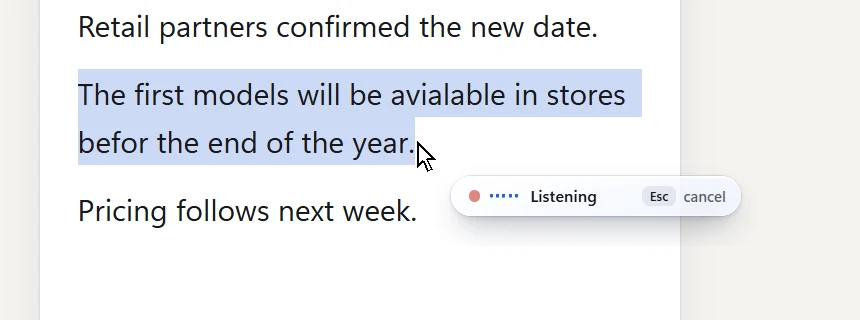 Voice commands, only while you hold the keys</td><td width="50%" valign="top">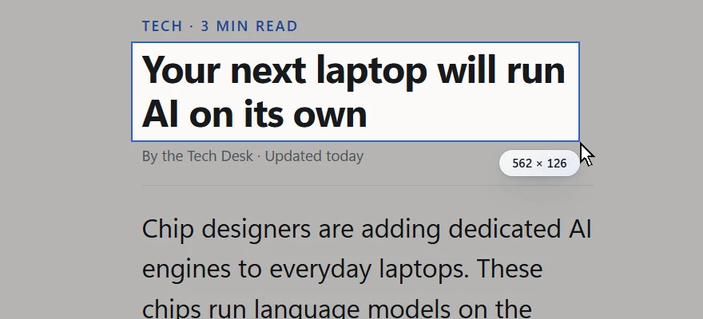 Screen text: drag over any text on screen</td></tr>
<tr><td width="50%" valign="top">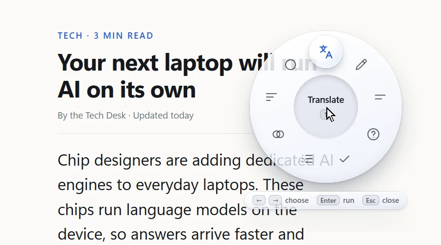 The ring with all 10 entries</td><td width="50%" valign="top">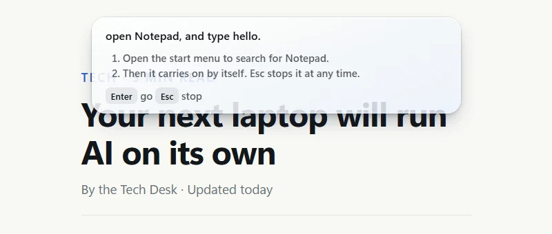 Computer control (experimental): approve the plan with Enter</td></tr>
<tr><td width="50%" valign="top">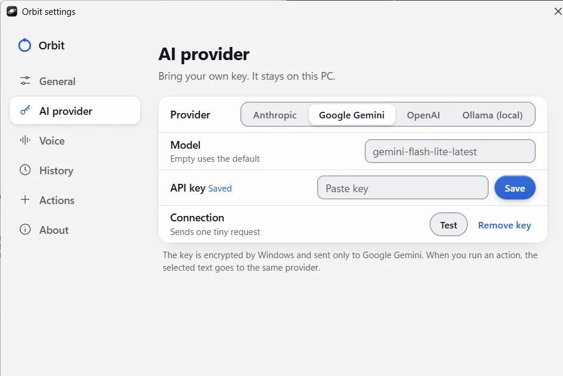 Your AI, your key: Anthropic, Gemini, OpenAI or Ollama</td><td width="50%" valign="top">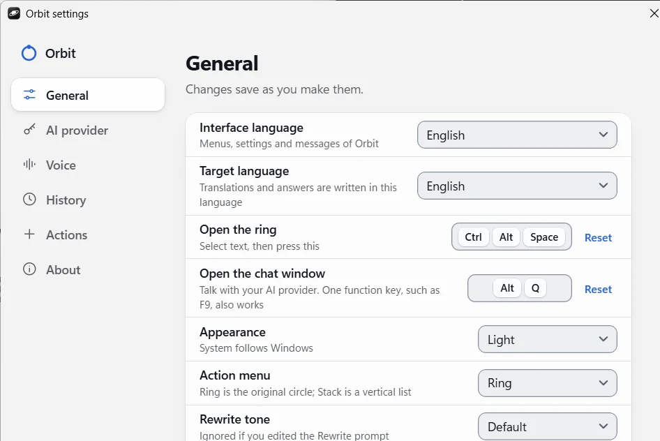 General settings</td></tr>
</table>

## Download

Get the latest installer from the [**Releases** page](../../releases/latest). Download `Orbit-Setup-<version>.exe` and run it.

- **Needs:** Windows 10 or 11, 64-bit.
- **SmartScreen:** the installer is not code-signed yet, so Windows may warn you. Choose *More info*, then *Run anyway*.
- **Updating:** Orbit tells you when a newer version is out and downloads it in the background, then asks whether to restart now or later. Later installs when you quit Orbit. Turn off *Check for updates* in Settings to stop all update traffic.
- **Uninstalling:** use *Apps & features* in Windows. Your settings are kept in case you reinstall.

## Get started in 2 minutes

1. **Run Orbit.** It lives in the system tray (bottom right of the taskbar). The first launch shows a short guided tour; replay it any time from the tray menu or Settings, About.
2. **Add an AI key.** Open Settings from the tray icon, go to **AI provider**, pick a provider and paste your API key. Press **Test connection** to check it.
   - Supported: Anthropic, Google Gemini, OpenAI.
   - Prefer to stay offline? Choose **Ollama** and a local model, no key needed.
3. **Select some text** in any app.
4. **Press `Ctrl+Alt+Space`.** A menu of actions opens at your pointer.
5. **Pick an action** with the number keys, or the arrow keys and Enter. `Esc` closes the menu.
6. **Read the answer** in the box beside your pointer. Ask a follow-up, copy it, or replace your selection with it.

## Shortcuts

| Shortcut | What it does |
|----------|--------------|
| `Ctrl+Alt+Space` | Open the action menu for the selected text |
| `1` to `9`, arrows, `Enter` | Pick an action in the menu |
| `Ctrl+Alt+F` | Follow up on the answer |
| `Ctrl+Alt+C` | Copy the answer |
| `Ctrl+Alt+V` | Replace your selected text with the answer (only when you press it) |
| `Ctrl+Alt+D` or `Esc` | Close the answer box |
| `Ctrl+Alt+R` | Read the selected text aloud (press again or `Esc` to stop) |
| `Ctrl+Alt+T` | Translate the selection into your language, then read it aloud |
| `Alt+Q` | Open the chat window |
| Hold `Ctrl+Alt+M` | Voice commands (optional, off by default) |
| Hold `Ctrl+Alt+A` | Computer control (optional, experimental, off by default) |

Every shortcut can be changed in Settings.

## What you can do with it

**Actions.** Eight come built in: **Translate, Explain, Examples, Synonyms, Rewrite, Summarize, Fix** and **Simplify**. The menu puts the most useful ones first, depending on whether you selected a word, a sentence, a paragraph, code or a link.

**Make them yours.** In Settings, Actions you can rename, edit or delete any default action (deleted ones can be restored), and add up to 4 of your own. Write what you want done in plain words, for example *"Reply politely and keep it under 50 words"*. Each action can use its own provider and model.

**Chat window.** Press `Alt+Q` for a full chat with the provider and key you already set. It streams the reply and keeps nothing on disk.

**Screen tools.** *Screenshot* copies a rectangle you drag to the clipboard. *Screen text* reads the text in it with the OCR built into Windows, then opens the menu on that text.

**Voice (optional).** Hold `Ctrl+Alt+M` and say what you need. Orbit can also read answers aloud with Google Gemini, OpenAI, or the offline voices built into Windows.

**Computer control (experimental, off by default).** Hold `Ctrl+Alt+A` and say a task such as "open Notepad and type hello". Orbit shows a plan, you approve it once, and then it moves your real mouse and types on your real keyboard. `Esc` stops it at any time. Password fields are refused. Every step sends a screenshot of your screen to Google Gemini, so use it only when you are comfortable with that.

**Two looks for the menu.** **Ring**, a circle of actions around your pointer, or **Stack**, a vertical list beside it.

**Languages.** Translate into any of 111 languages. Orbit's own menus are available in English, French, Spanish, German and Arabic.

**Look.** Light and dark themes that follow Windows, or choose one yourself.

**History (optional).** Off by default. If you turn it on, Orbit keeps recent results on your PC for 7 days, then deletes them.

## Privacy

- Nothing is sent until you pick an action.
- The selected text goes only to the provider you chose. With Ollama it never leaves your PC.
- Your API key is stored encrypted on your PC (Windows data protection) and is only sent to the provider you picked.
- Orbit briefly copies your selection to read it, then restores your clipboard. A clipboard manager may record that copy.
- No account and no tracking. Orbit logs never contain your text.
- Screenshot and Screen text only look at the screen when you pick them. The picture is never sent anywhere.
- Voice commands are off until you turn them on. The microphone is open only while you hold the shortcut, and that audio is sent to Google Gemini to be turned into text, never recorded or stored.
- Cloud read-aloud voices send the spoken text to Google or OpenAI.
- **Update check:** once a day Orbit asks this repository for the latest release number. It sends no data about you, and you can turn it off in Settings, General.

## Good to know

- Orbit can't read text inside windows running as administrator.
- The installer is unsigned, so SmartScreen shows a warning the first time.
- You need your own API key for Anthropic, Gemini or OpenAI, and those providers may charge for use. Ollama is free.
- Some error messages and screen-reader labels stay in English.

## Help and feedback

This page only hosts the installers and the media you see above. If something doesn't work, open an [issue](../../issues) and say which Orbit version you have (Settings, About).
